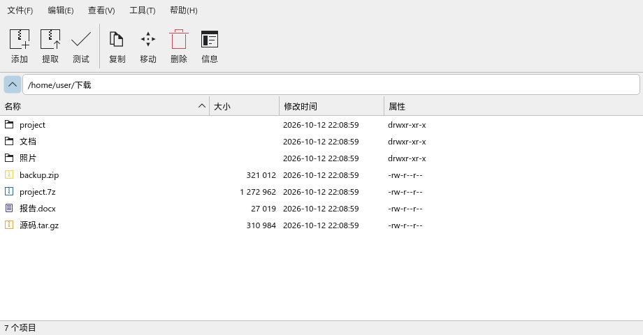
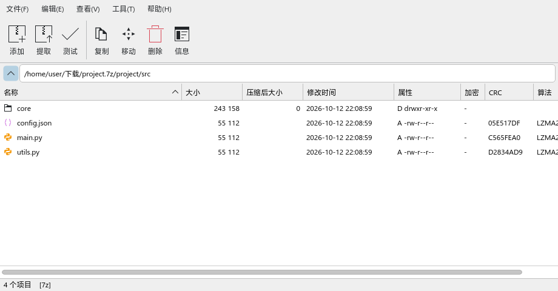
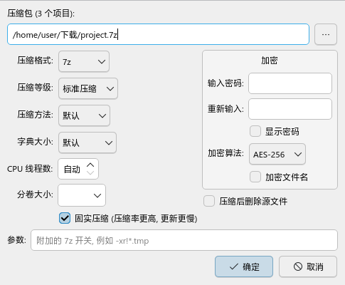
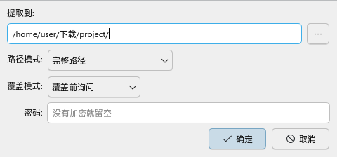

# 7zfm

7-Zip 风格的文件管理器 / 压缩工具，面向 Linux (KDE)。界面用 Qt6 (PySide6) 编写，
压缩和解压全部交给系统的 `7z` 命令，所以引擎跟随发行版更新。





| 添加到压缩包 | 提取 |
| --- | --- |
|  |  |

## 功能

- 仿 Windows 版 7-Zip 的单面板界面：添加 / 提取 / 测试 / 复制 / 移动 / 删除 / 信息
- 浏览文件夹、压缩包、压缩包里的压缩包；`tar.gz` 一类直接显示内部文件
- 压缩为 7z、zip、tar、tar.gz、tar.xz、tar.bz2、tar.zst，支持等级、方法、字典、线程、分卷、密码
- 解压时同名文件可选 询问 / 覆盖 / 跳过 / 自动重命名，加密压缩包会弹出密码框
- 在 7z / zip / tar 内添加、删除、重命名文件
- Dolphin 右键菜单、文件关联、应用菜单条目

## 依赖

| 软件包 (Arch 包名) | 是否必须 | 用途 |
| --- | --- | --- |
| `python` (3.9 及以上) | 必须 | 运行程序本身，只用标准库 |
| `pyside6` | 必须 | Qt6 界面 |
| `7zip` | 必须 | 提供 `7z` 命令，所有压缩、解压、列表、测试、校验和都靠它 |
| `zstd` | 可选 | 压缩成 `tar.zst`；没有时只是这一种格式用不了 |
| `kde-cli-tools` | 可选 | 提供 `kioclient`，用于磁盘文件的「复制到 / 移动到」 |
| `xdg-utils` | 可选 | `install.sh` 用 `xdg-mime` 设置默认打开方式 |
| Dolphin (KDE Plasma 6) | 可选 | 右键菜单；其他桌面仍可用主程序和命令行 |

没有第三方 Python 库，也不需要编译。RAR 只能解压不能创建，这是 7-Zip 本身的限制。

开发和测试环境：CachyOS (Arch)，KDE Plasma 6.7，Python 3.14，PySide6 6.11，7-Zip 26.03。
其他发行版没有实测过。

Arch 系安装依赖：

```sh
sudo pacman -S --needed python pyside6 7zip zstd kde-cli-tools xdg-utils
```

## 安装

```sh
./install.sh              # 安装到 ~/.local，并设为压缩包的默认打开方式
./install.sh --no-default # 不改默认打开方式
./uninstall.sh            # 卸载并恢复原来的默认程序
```

## 命令行

```
7zfm [路径]                      打开文件夹或压缩包
7zfm --add 文件...               打开“添加到压缩包”对话框
7zfm --add-to 7z|zip|... 文件... 直接压缩
7zfm --extract 压缩包...         打开“提取”对话框
7zfm --extract-here 压缩包...    解压到当前文件夹
7zfm --extract-sub 压缩包...     解压到同名文件夹
7zfm --test 压缩包...            测试
```

## 测试

```sh
cd tests && python3 test_fm.py ../7zfm.py
```

## 许可证

[MIT](LICENSE)。7-Zip 本身不包含在本仓库中，它有自己的许可证。
